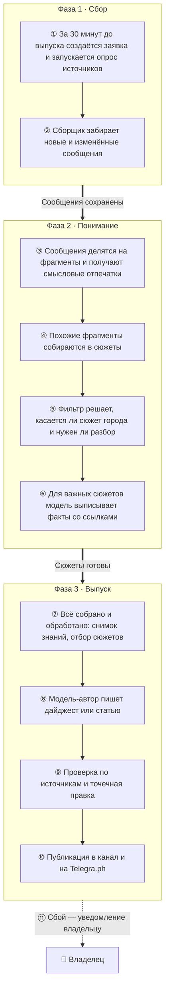
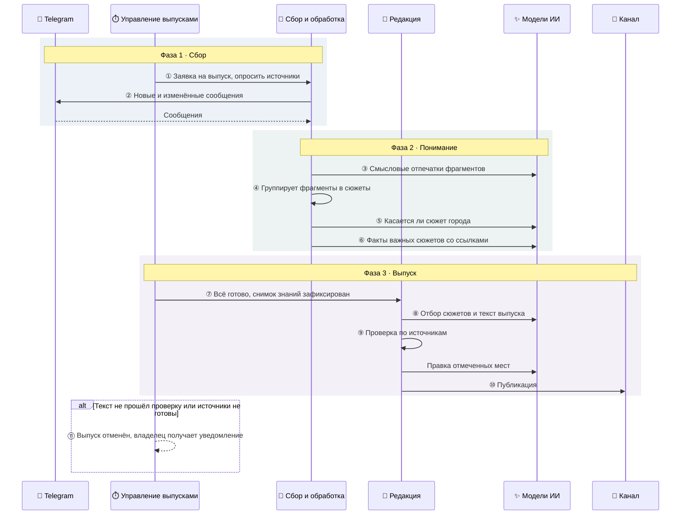

# Общая карта процессов

::: tldr
**Коротко.** Каждый выпуск проходит три фазы. *Сбор*: за полчаса до выпуска система забирает свежие сообщения. *Понимание*: сообщения превращаются в сюжеты, фильтр решает, что касается города, модель выписывает факты. *Выпуск*: по замороженному снимку сюжетов модель пишет текст, проверка сверяет его с источниками, и только проверенный текст уходит в канал. Ниже — фазы, упрощённая диаграмма и шаги со ссылками на сценарии.
:::

### 1\. Фазы

Фаза 2 работает и вне выпусков: фильтр и разбор догоняют новые сюжеты в фоне. Поэтому к моменту выпуска большая часть сюжетов уже разобрана.

### 2\. Упрощённая диаграмма взаимодействия

Сервер показан тремя ролями. Полная диаграмма со всеми задачами очереди и записями в базу — на Уровне 3: [сквозная диаграмма](#l3-end-to-end).

### 3\. Шаги и где о них читать

| Шаг | Кто → кому | Что происходит | Процесс (Уровень 2) |
| --- | --- | --- | --- |
| ① | Управление выпусками → Сбор | За полчаса до выпуска создаётся заявка и запускается опрос всех источников издания. | [Сценарий 1](#l2-ingestion) |
| ② | Сбор → Telegram | Сборщик читает свежие сообщения и сохраняет новые версии отредактированных. | [Сценарий 1](#l2-ingestion) |
| ③ | Обработка → Эмбеддинги | Сообщения делятся на фрагменты, для каждого считается смысловой отпечаток. | [Сценарий 1](#l2-ingestion) |
| ④ | Обработка | Похожие фрагменты за последние трое суток собираются в сюжеты. | [Сценарий 1](#l2-ingestion) |
| ⑤ | Обработка → Модели | Фильтр решает, касается ли сюжет города, оставить ли его и нужен ли разбор. | [Сценарий 1](#l2-ingestion) |
| ⑥ | Обработка → Модели | Модель выписывает факты важных сюжетов с точными ссылками на фрагменты. | [Сценарий 1](#l2-ingestion) |
| ⑦ | Управление → Редакция | Все источники собраны и обработаны: фиксируется снимок знаний, сюжеты отбираются. | [Сценарий 2](#l2-digest) |
| ⑧ | Редакция → Модели | Модель-автор пишет дайджест по плану рубрик. | [Сценарий 2](#l2-digest) |
| ⑨ | Редакция → Модели | Проверка сверяет текст с источниками, редактор исправляет отмеченные места. | [Сценарий 2](#l2-digest) |
| ⑩ | Доставка → Канал | Дайджест уходит в канал одним постом. | [Сценарий 2](#l2-digest) |
| ⑪ | Управление → Владелец | При отмене выпуска владелец получает уведомление; владелец может запустить выпуск вручную. | [Сценарий 2](#l2-digest) |

### 4\. Другие сценарии

Шаги ①–⑪ описывают плановый дайджест. Остальные сценарии используют те же фазы, но отличаются выпуском или работают в фоне:

| Сценарий | Когда | Чем отличается |
| --- | --- | --- |
| [Сценарий 3: Вечерняя статья](#l2-article) | Каждый день в 21:15; по воскресеньям — «Итоги недели» в 19:00 | Те же фазы 1–2; в фазе 3 — лонгрид на Telegra.ph с обложкой и пост-анонс |
| [Сценарий 4: Итоги месяца, квартала, года](#l2-period-review) | 1-го числа, в начале квартала и года, в 18:00 | Без свежего сбора: ждёт, пока фоновая хроника закроет период |
| [Сценарий 5: Фоновое обслуживание](#l2-maintenance) | По расписанию, без выпуска | Хроника, память о ситуациях, очистка, восстановление, предупреждения |

