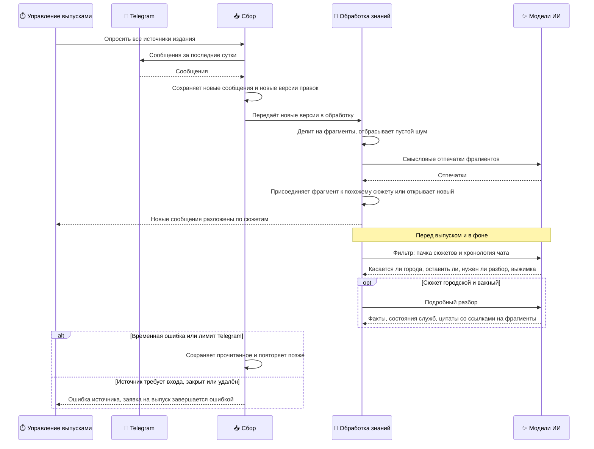

## От сообщения к сюжету

Сценарий описывает путь сообщения от публикации в городском чате до сюжета, которым может пользоваться редакция. Запускает его управление выпусками за 30 минут до каждого выпуска или владелец ручной командой. Дальше обработка идёт сама, цепочкой фоновых задач.

- **Участники:** источники в Telegram, сбор, обработка знаний, модели ИИ, управление выпусками.
- **Результат:** сообщения сохранены вместе с историей правок и разложены по сюжетам; у каждого сюжета есть решение фильтра и короткая выжимка, у важных — подробный разбор с фактами.

### Как это работает

- **Сбор идёт перед выпуском, а не постоянно.** Опрос источников по собственному расписанию в коде есть, но выключен настройкой. Источники опрашиваются за полчаса до каждого выпуска и по ручной команде владельца.
- **Повторное чтение безопасно.** Сборщик каждый раз перечитывает последние сутки целиком: так он замечает правки старых сообщений. Сообщение с тем же текстом второй раз не сохраняется, отредактированное получает новую версию. Если за время простоя сообщений накопилось больше, сборщик догружает пропуск с прошлой отметки.
- **Обработка ставится в очередь вместе с сообщениями.** Задача обработки записывается в ту же транзакцию, что и сами сообщения. Ситуация «сообщение сохранено, а обработать забыли» невозможна — иначе выпуск ждал бы его вечно. Дополнительно каждые 10 минут фоновая проверка подбирает незавершённые версии.
- **Короткие реплики не теряются.** На этапе фрагментов отбрасываются только пустые благодарности и подобный шум. Короткое «на Горе нет света» доходит до фильтра.
- **Сюжеты собираются без языковой модели.** Фрагмент присоединяется к сюжету, если его смысловой отпечаток достаточно близок к одному из сюжетов последних трёх суток; иначе открывается новый сюжет. У короткой реплики вроде «Колония нету» отпечаток почти целиком описывает разговорный тон, поэтому её присоединяют только по ответу на сообщение, по почти дословному совпадению или к сюжету с соседним сообщением того же чата ([ADR-0001](#adr-0001)).
- **Фильтр читает чат как разговор.** Вместе с сюжетами модель получает хронологию чата: из неё видно, о какой услуге говорит «Колония нету». Хронология — контекст, а не источник фактов: место, число или цитата, взятые только из соседней реплики, в выпуск не попадут.
- **Географию решает фильтр, а не автор.** То, что сообщение пришло из городского чата, не доказывает, что событие городское. Общие областные сводки и сообщения о «Бердянском направлении» фронта отсекаются, если в них нет прямого последствия для города.
- **Решения привязаны к версии логики.** Когда меняются правила фильтра или разбора, уже сохранённые решения остаются со старой версией. Для честного сравнения «до и после» сюжеты нужно переобработать ([Уровень 3](#l3-ingestion-detail)).

### Гарантии и ограничения

- Фрагмент принадлежит ровно одному сюжету; сюжет при этом может включать сообщения из разных источников.
- Источник считается собранным, только когда сбор завершился успешно. Временные ошибки и лимиты Telegram повторяются, а «нужен вход», «доступ закрыт» и «источник не найден» сразу останавливают заявку на выпуск.
- Фильтр не задерживает выпуск: сюжеты, которые он ещё не разобрал к моменту снимка, просто не попадают в этот выпуск ([ADR-0004](#adr-0004)).
- Подробный разбор делается только для городских сюжетов, которые фильтр оставил и пометил как важные; остальным достаточно выжимки.
- Вопрос жителя («работает ли пенсионный фонд?») сохраняется как контекст и не превращается в утверждение о работе службы.
- Тексты сообщений, сюжеты и решения хранятся бессрочно; рабочие отпечатки фрагментов удаляются через 14 дней после того, как сюжет затих.

### Детали на Уровне 3

| Что | Где |
| --- | --- |
| Задачи очереди, лимиты, версии и таблицы | [Сбор и обработка знаний](#l3-ingestion-detail) |
| Заявка на выпуск и проверка готовности | [Заявка на выпуск и готовность](#l3-readiness-detail) |
| Все шаги одной диаграммой | [Сквозная диаграмма](#l3-end-to-end) |
| Почему сюжеты собираются без модели | [ADR-0001](#adr-0001) |
| Почему фильтр не барьер готовности | [ADR-0004](#adr-0004) |
| Почему одного сообщения жителя достаточно | [ADR-0002](#adr-0002) |

