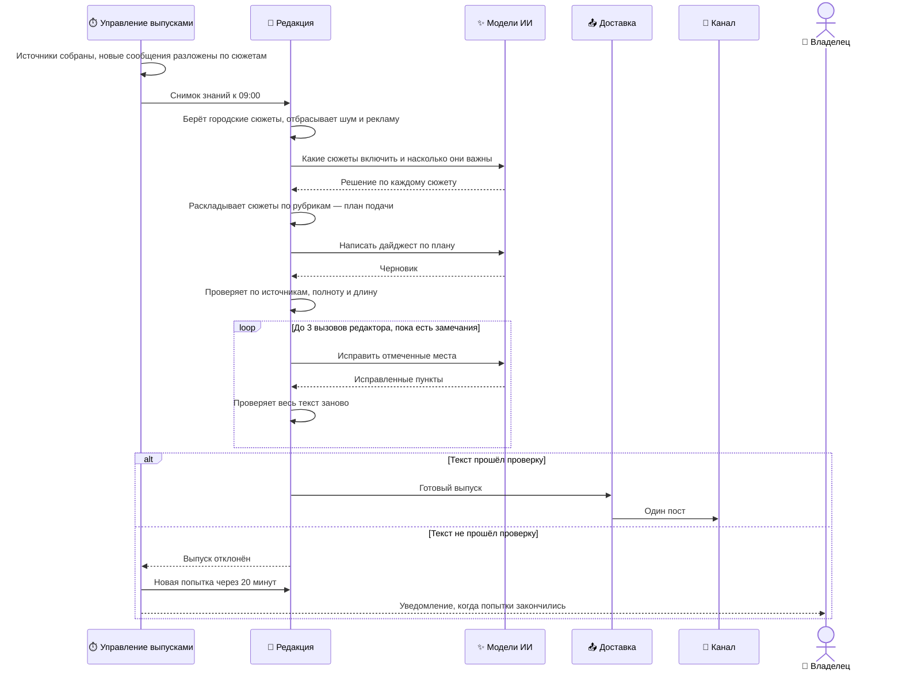

## Ежедневный дайджест

Каждый день в 09:00 по Киеву система публикует в канал дайджест: короткие пункты по рубрикам о том, что происходило в городе за последние сутки. Выпуск запускается по расписанию; владелец может запустить его и вручную командой в боте.

- **Участники:** управление выпусками, редакция, модели ИИ, доставка, канал, владелец.
- **Результат:** один пост в канале, в котором представлен каждый отобранный сюжет и каждое утверждение опирается на источник. Если такой текст не получился — выпуска нет, владелец получает уведомление.

### Как это работает

- **Выпуск ждёт данных, но не бесконечно.** Заявка переходит к подготовке, когда все источники собраны и все новые сообщения разложены по сюжетам. Если всё готово раньше 09:00, заявка ждёт своего времени. Если к 11:00 подготовка так и не началась, выпуск отменяется.
- **Снимок защищает выпуск.** Перед генерацией система фиксирует, какие сюжеты и в каком состоянии участвуют. Сообщение, пришедшее во время генерации, не изменит текст наполовину, а сам выпуск можно воспроизвести для разбора.
- **Отбор расставляет приоритеты, а не проверяет факты.** Модель отбора решает, что включить и с каким весом; при большом потоке вперёд идут главные события дня, коммунальная обстановка, безопасность, городские службы, транспорт и связь. Если модель отбора недоступна или ответила некорректно, срабатывает простой отбор по правилам — выпуск из-за этого шага не срывается.
- **Частная болтовня не попадает в план.** Жалоба одного человека «нет света, воды и отопления» без места или единственная реплика «у меня всё есть» остаются в базе, но в дайджест не идут: автор может жить где угодно. Сообщение с улицей, причиной или от нескольких людей сохраняется.
- **Пункт дайджеста — не то же, что сюжет.** Несколько сюжетов о воде в разных кварталах становятся одним пунктом: «💧 в нагорной части неоднородно: на одних улицах вода есть, на других насос стоит». Проверка полноты считает сюжеты и факты внутри пунктов, а не число пунктов.
- **Модель пишет, правила проверяют.** Черновик — один вызов модели-автора. Затем детерминированная проверка ищет выдуманные места, числа, причины, искажённые цитаты, пропущенные сюжеты и превышение длины. Редактор-корректор правит только отмеченные места и не больше 3 раз: первый вызов может перестроить рубрики, второй исправляет ошибки, третий — только если текст не влезает в пост или остались стилистические замечания.
- **Запасного текста нет.** Склеить сообщения «как есть» система не может даже при сбое модели ([ADR-0003](#adr-0003)). Сорванный плановый дайджест повторяется с интервалом 20 минут, всего до 3 попыток, пока остаётся время до конца двухчасового окна. Владелец получает одно уведомление — когда попытки закончились.

### Гарантии и ограничения

- В канал попадает только текст, целиком прошедший проверку по источникам.
- Каждый сюжет, вошедший в план подачи, и каждый обязательный факт представлены в тексте; удалить их, чтобы влезть в пост, редактор не может.
- Пост не длиннее 4096 символов; цель — 2500–3700. Текст никогда не обрезается механически.
- Внутренняя «кухня» сбора — «в чатах», «перекличка», названия каналов — в текст не попадает.
- Статистика в конце поста выводится, только если включена настройкой; сейчас выключена.
- Ручной запуск проходит тот же путь, но без автоматических повторов.
- Пост не публикуется дважды. Если связь с Telegram оборвалась во время отправки и неизвестно, дошёл ли пост, система не отправляет его повторно: такую доставку проверяет человек.
- Сообщения, пришедшие после снимка, попадут только в следующий выпуск.

### Детали на Уровне 3

| Что | Где |
| --- | --- |
| Состояния заявки, окна времени и причины отказа | [Заявка на выпуск и готовность](#l3-readiness-detail) |
| Отбор, план подачи, автор, проверка, редактор, доставка | [Дайджест: генерация и проверка](#l3-digest-detail) |
| Все шаги одной диаграммой | [Сквозная диаграмма](#l3-end-to-end) |
| Почему нет запасного текста | [ADR-0003](#adr-0003) |
| Почему выпуск не ждёт фильтр | [ADR-0004](#adr-0004) |
| Известные риски выпуска | [Риски и технический долг](#l3-risks) |

