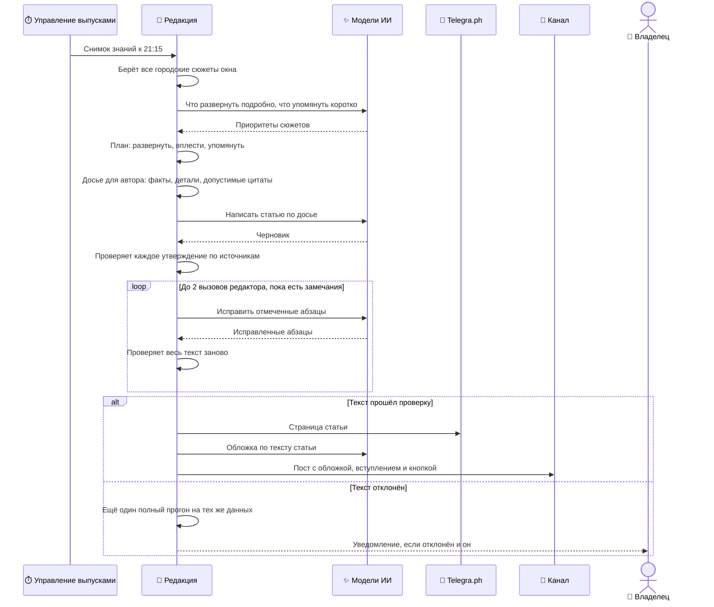

## Вечерняя статья

Каждый вечер в 21:15 по Киеву система публикует большой текст о том, как город прожил последние сутки. Сама статья размещается на Telegra.ph, а в канал уходит пост с обложкой, заголовком, коротким вступлением и кнопкой «Читать статью полностью». По воскресеньям вместо неё в 19:00 выходят «Итоги недели» за семь дней.

- **Участники:** управление выпусками, редакция, модели ИИ, Telegra.ph, доставка, канал, владелец.
- **Результат:** связный лонгрид, в котором главное развёрнуто подробно, второстепенное вплетено в текст, а каждое утверждение опирается на источник. Если такого текста не получилось — статьи нет, владелец получает уведомление.

### Как это работает

- **Статья не отбрасывает сюжеты, а распределяет место.** Главное развивается на несколько абзацев, заметное вплетается в разделы, мелкое упоминается одной фразой. Отбор решает, сколько места дать сюжету, а не допускать ли его вообще ([ADR-0005](#adr-0005)).
- **Детали — главная ценность.** «Жильцы скинулись по 300 рублей на домовой генератор» лучше, чем «жители адаптируются». План заранее отмечает такие детали, чтобы автор их сохранил.
- **Объявления не захватывают текст.** Телефоны, ссылки на бронирование, прайс-листы и рекламный текст не попадают в досье автора; исходные сообщения при этом остаются в базе.
- **Длина зависит от дня.** Тихий день даёт короткую статью без «воды», насыщенный — длинную, с бо́льшим числом разделов.
- **Окно начинается там, где закончился прошлый выпуск.** Статья не пересказывает вчерашнюю: материал, уже вышедший в прошлой статье, в текст не попадает. Если по сюжету вышло только старое, сюжет из статьи выпадает ([ADR-0009](#adr-0009)).
- **Время и голоса проверяются.** Прошлое событие датируется своим днём, а не звучит как сегодняшнее. Слова «сегодня» и «вчера» сверяются с днём, когда сообщение отправили. «Другой житель» требует другого автора: один житель, написавший несколько сообщений, не становится несколькими людьми.
- **Названия выровнены.** Местные термины приводятся к принятому написанию, прямые цитаты при этом не меняются.
- **Один автор и аккуратный редактор.** Черновик пишет одна модель за один вызов. Редактор исправляет только отмеченные места, может перенести абзац в подходящий раздел или пересобрать несколько абзацев, но не переписывает статью целиком ([ADR-0006](#adr-0006)). Если модель вернула пустой ответ или отказ, один раз используется следующая модель из списка.
- **Блокирует только опасное.** Выдуманные места, числа, причины, искажённые цитаты и вводящие в заблуждение сочетания останавливают статью: время или число, приписанные не тому источнику, вчерашнее событие, поданное как сегодняшнее, «другой житель» без другого автора. Стилистические замечания уходят редактору и выпуск не отменяют.
- **Один повтор целиком.** Если проверка отклонила статью, система один раз запускает всю генерацию заново на тех же данных: модель недетерминирована, и второй черновик может пройти.
- **Неделя — те же правила на семи днях.** «Итоги недели» собирают сюжеты в сквозные линии по времени и учитывают, что уже выходило за неделю.

### Гарантии и ограничения

- В статью попадает только текст, целиком прошедший проверку по источникам. Прямые цитаты дословны; если цитату нужно сократить или перевести, она становится косвенной речью.
- Сообщение жителя остаётся сообщением жителя: «по словам жителей», а не установленный факт ([ADR-0002](#adr-0002)). Оговорки («похоже», «по словам соседей») сохраняются в тексте.
- Цитата из сообщения с замаскированным словом или с бранью в статью не попадает.
- Внутренняя «кухня» сбора и названия чатов в текст не попадают.
- Число обращений к модели ограничено: один автор (плюс одна замена при непригодном ответе), не больше двух вызовов редактора, один повтор всего прогона.
- Страница Telegra.ph и обложка не обязательны: если их создать не удалось, статья всё равно выходит, но пост в канале выглядит иначе ([Риски](#l3-risks)).
- Ручной запуск командой `/article` проходит тот же путь.

### Детали на Уровне 3

| Что | Где |
| --- | --- |
| План покрытия, досье, проверки, редактор, лимиты, коды отказа | [Статья: генерация и проверка](#l3-article-detail) |
| Состояния заявки и окна времени | [Заявка на выпуск и готовность](#l3-readiness-detail) |
| Почему глубина вместо отсева | [ADR-0005](#adr-0005) |
| Почему один автор и ограниченный редактор | [ADR-0006](#adr-0006) |
| Почему нет запасного текста | [ADR-0003](#adr-0003) |
| Почему материал прошлой статьи не повторяется | [ADR-0009](#adr-0009) |

