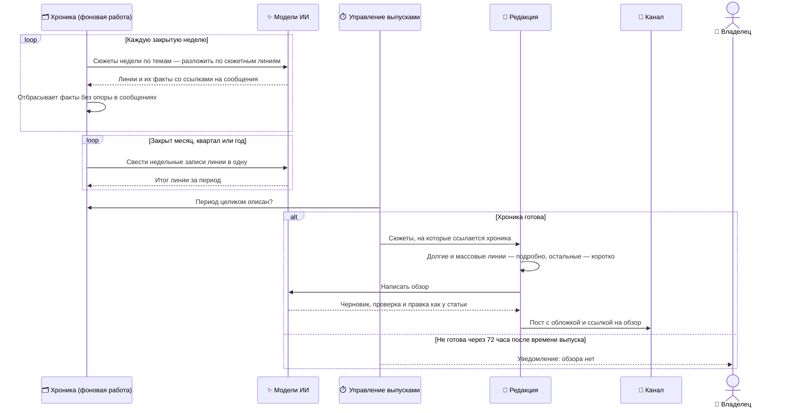

## Итоги месяца, квартала и года

Раз в месяц, квартал и год система публикует большой обзор закрытого периода: какие истории тянулись дольше всего и коснулись большинства жителей, чем они закончились, что ещё происходило в городе. Обзор — такая же статья, как в [Сценарии 3](#l2-article), но материал для неё готовится заранее, неделя за неделей.

- **Участники:** фоновое обслуживание (хроника), управление выпусками, редакция, модели ИИ, Telegra.ph, канал, владелец.
- **Результат:** обзор на Telegra.ph и пост в канале с плашкой «ПАНОРАМА МЕСЯЦА», «ИТОГИ КВАРТАЛА» или «ИТОГИ ГОДА». Если хроника не готова за трое суток после времени выпуска — обзора нет, владелец получает уведомление.

### Как это работает

- **Хроника — память редакции.** Каждые две часа фоновая работа берёт следующую закрытую неделю и раскладывает её сюжеты по сюжетным линиям внутри тем («Электроснабжение», «Транспорт» и т. д.). Каждый сюжет попадает ровно в одну линию — в неделю, когда он впервые появился; сюжет, не вошедший ни в одну линию, идёт в «прочие новости» своей темы ([ADR-0007](#adr-0007)).
- **Запись хроники — навигация, а не источник.** Обзор публикует только факты из исходных сообщений тех сюжетов, на которые ссылается хроника. Числа и даты в записи хроники должны найтись в процитированных сообщениях; поле, которое не прошло проверку, выбрасывается.
- **Вес линии — длительность и охват.** Чем больше дней тянулась история и чем больше независимых источников о ней сообщали, тем больше места она получает. Небольшие линии не исчезают, а упоминаются коротко.
- **Неделя ждёт обработку.** Неделя закрывается, когда обработка сообщений догнала её конец, но не позже чем через двое суток. Отставание обработки задерживает обзор, а не делает его тоньше.
- **Обзору не нужен свежий сбор.** Он описывает закрытый период, поэтому не ждёт чатов перед выпуском — только готовности хроники.
- **Честный неполный период.** Если сбор начался в середине периода, заголовок и вступление говорят об этом: «Итоги 2026 года: сентябрь–декабрь».
- **Те же правила, что у статьи.** Один автор, до двух вызовов редактора, проверка по источникам и один повтор прогона ([ADR-0006](#adr-0006)); у обзора просто больше времени на генерацию.

### Гарантии и ограничения

- В обзор не попадает факт, которого нет в исходных сообщениях: хроника этого не разрешает.
- Каждый сюжет периода привязан к одной линии; укрупнение и лимиты фактов меняют подачу, но не выбрасывают сюжеты из хроники.
- Расписание: месяц — 1-го числа, квартал — 3-го числа января, апреля, июля и октября, год — 7 января, всё в 18:00 по Киеву. Полугодовой обзор включится с июля 2027 года.
- Еженедельные «Итоги недели» строятся не по хронике, а как статья за семь дней ([Сценарий 3](#l2-article)).

### Детали на Уровне 3

| Что | Где |
| --- | --- |
| Хроника: таблицы, расписание, лимиты, проверки записей | [Хроника и итоги периода](#l3-period-review-detail) |
| Готовность обзора и окна времени | [Хроника и итоги периода](#l3-period-review-detail), [Заявка на выпуск](#l3-readiness-detail) |
| Генерация, проверка, редактор | [Статья: генерация и проверка](#l3-article-detail) |
| Почему обзор строится на хронике | [ADR-0007](#adr-0007) |

