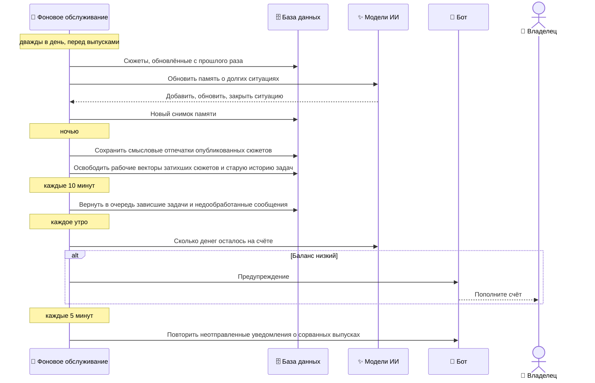

## Фоновое обслуживание

Между выпусками система сама поддерживает себя в рабочем состоянии: обновляет память о долгих ситуациях в городе, ведёт хронику, убирает отработавшие рабочие данные, перезапускает зависшую работу и предупреждает владельца о проблемах. Никто эти задачи не запускает — они идут по расписанию.

- **Участники:** фоновое обслуживание, база данных, модели ИИ, бот, владелец.
- **Результат:** выпуски получают контекст о долгих ситуациях, база не разрастается рабочими векторами, сбои не остаются незамеченными.

### Как это работает

- **Память о ситуациях — фон, а не источник.** Дайджест читает одни сутки, но житель помнит, что свет нестабилен с августа. Память хранит до десяти долгих ситуаций (свет, вода, связь, транспорт…), обновляет их по новым сюжетам и закрывает те, которые давно никто не подтверждал. Дайджест получает её как фон; опубликовать можно только то, что есть в сообщениях окна.
- **Хроника — для обзоров.** Каждые два часа хроника дописывает закрытые недели и сворачивает завершённые месяцы ([Сценарий 4](#l2-period-review)).
- **Знания не удаляются никогда.** Тексты сообщений, сюжеты, их версии, хроника и публикации хранятся бессрочно. Удаляется только рабочее состояние, которое уже не нужно: векторы для склейки сюжетов, когда сюжет затих, история выполненных задач и служебные отметки сбора ([ADR-0008](#adr-0008)).
- **Зависшее подбирается само.** Если воркер упал посреди задачи, задача возвращается в очередь; сообщения, которые не дошли до сюжетов, отправляются на обработку повторно.
- **Владелец узнаёт о проблемах.** Бот предупреждает о низком балансе и дневном лимите OpenRouter, а уведомления о сорванных выпусках, которые не удалось отправить, повторяются, пока не дойдут.

### Гарантии и ограничения

- Сбой памяти о ситуациях не останавливает дайджест: тот выходит без фона.
- Очистка идёт маленькими порциями с паузами, чтобы не мешать обработке.
- Каждая периодическая задача выполняется в одном экземпляре одновременно.
- Баланс проверяется раз в сутки; деньги могут закончиться между проверками ([Риски](#l3-risks)).

### Детали на Уровне 3

| Что | Где |
| --- | --- |
| Расписания, лимиты, сроки хранения | [Обслуживание и хранение](#l3-maintenance-detail) |
| Хроника сюжетных линий | [Хроника и итоги периода](#l3-period-review-detail) |
| Все периодические задачи | [Сквозная диаграмма](#l3-end-to-end) |
| Почему знания хранятся бессрочно | [ADR-0008](#adr-0008) |

