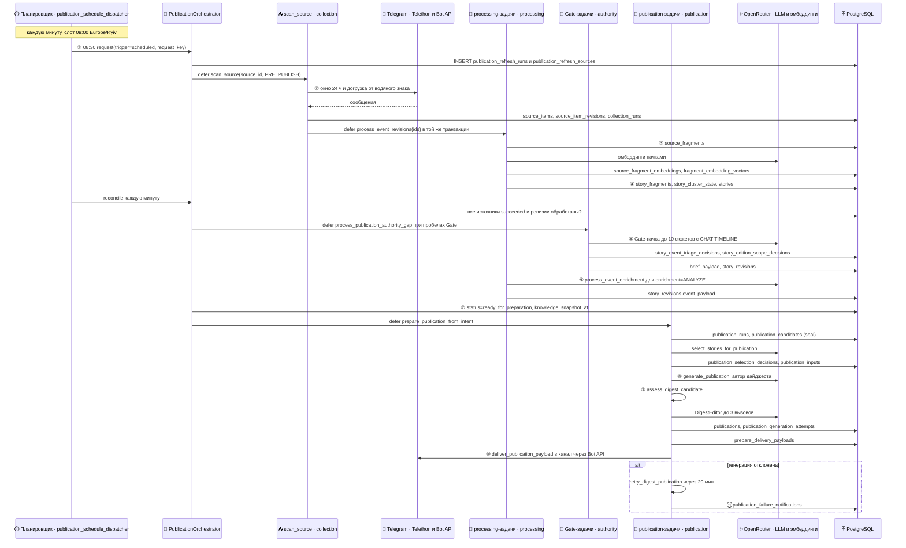

## Сквозная диаграмма планового дайджеста

Процесс простыми словами — в [карте процессов](#l2-interaction-map). Здесь те же шаги ①–⑪ на уровне задач очереди Procrastinate, процессов Docker Compose и таблиц PostgreSQL.

::: tldr
**TL;DR для разработчика.** Всю оркестрацию держит Procrastinate: периодическая задача `publication_schedule_dispatcher` раз в минуту создаёт и сверяет заявки (`publication_refresh_runs`). Сбор, обработка, фильтр, отбор, генерация и доставка — отдельные задачи в очередях `collection`, `processing`, `authority`, `publication`, которые ставятся в той же транзакции, что и данные. Процесс `telebrief-app` с ботом сам ничего не генерирует — он лишь создаёт заявку.
:::

### Процессы и очереди

| Процесс Compose | Команда | Очереди | Параллельность |
| --- | --- | --- | --- |
| `telebrief-app` | `python main.py` | — (бот, MCP-сервер, создание заявок) | — |
| `telebrief-worker` | `python -m src.worker` | `publication`, `maintenance` | 2 |
| `telebrief-processing-worker` | `python -m src.worker` | `processing`, `collection`, `enrichment`, `default` | 1 |
| `telebrief-authority-worker` | `python -m src.worker` | `authority` | 2 |
| `telebrief-migrate` | `python scripts/migrate.py` | — (один раз перед стартом) | — |
| `postgres` | `pgvector/pgvector:pg18` | — | `max_connections=50` |

`validate_worker_configuration` запрещает больше 2 параллельных задач для очереди `processing` (пока обновления кластеров не сериализованы полностью) и больше 4 для `authority` (иначе исчерпываются соединения БД и лимиты провайдера). Голый `procrastinate worker` запускать нельзя: он не устанавливает рантайм (`src/runtime.py`), без которого падает любая задача.

### Периодические задачи

| Задача | Расписание (UTC) | Что делает |
| --- | --- | --- |
| `publication_schedule_dispatcher` | каждую минуту | Сверяет открытые заявки, создаёт новые по расписанию |
| `dispatch_due_sources` | каждую минуту | Плановый опрос источников; выходит сразу, пока `periodic_ingestion_enabled: false` |
| `requeue_unfinished_revisions` | каждые 10 минут | Подбирает застрявшие ревизии, до 500 за проход |
| `retry_stalled_jobs` | каждые 10 минут | Возвращает в очередь задачи, зависшие в состоянии `doing` |
| `periodic_event_enrichment_dispatch` | каждые 5 минут | Ставит Rich Analysis для сюжетов с `enrichment=ANALYZE`, до 40 за цикл |
| `periodic_background_authority_dispatch` | в 0 минут каждого 5-го часа | Фоновый Gate для накопившихся сюжетов |
| `publication-failure-notification-redrive` | каждые 5 минут | Повторяет неотправленные уведомления о сбое |
| `storyline-chronicle` | в 35 минут каждого 2-го часа | Хроника сюжетных линий для итогов периода |
| `situation-memory-update` | 04:20 и 16:20 | Память о текущих ситуациях для дайджеста |
| `retention-cleanup` | 03:15 | Очистка рабочих векторов, истории задач и наблюдений сбора |
| `openrouter-balance-check` | 07:00 | Предупреждение владельцам о низком балансе OpenRouter |
| `facebook-deep-sweep` | каждые 6 часов | Глубокий обход Facebook; без включённого Facebook не работает |

### Implementation References:

- **Telebrief:** `docker-compose.yml` (процессы и очереди), `src/worker.py` (`WORKER_QUEUES`, `validate_worker_configuration`), `src/jobs/app.py` (приложение Procrastinate).
- **Telebrief:** `src/jobs/schedules.py`, `src/jobs/ingestion.py`, `src/jobs/event_processing.py`, `src/jobs/event_authority.py`, `src/jobs/event_enrichment.py`, `src/jobs/publication.py`, `src/jobs/maintenance.py`, `src/jobs/facebook.py`.

[↑ Общая карта процессов (Уровень 2)](#l2-interaction-map)
