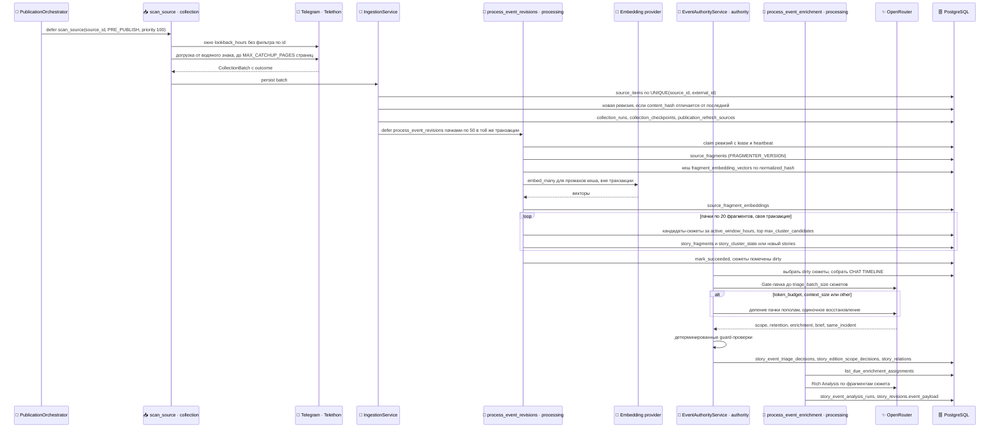
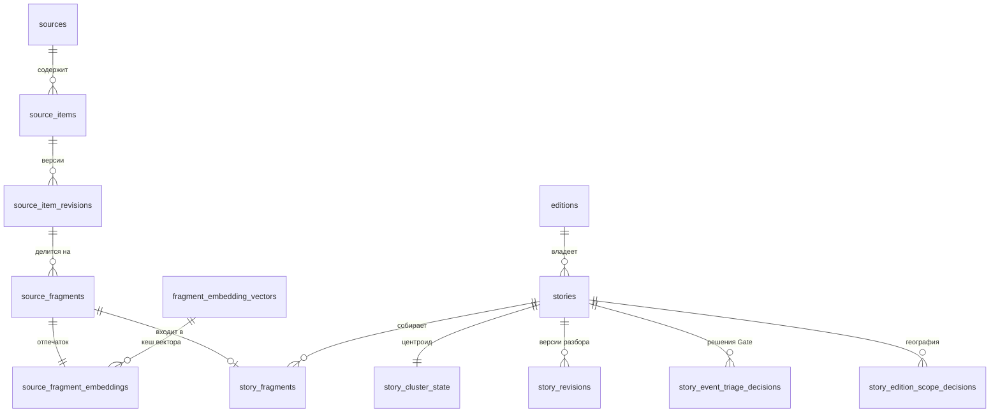

## Сбор и обработка знаний

Процесс простыми словами — в [Сценарии 1](#l2-ingestion). Обоснования — [ADR-0001](#adr-0001), [ADR-0002](#adr-0002), [ADR-0004](#adr-0004).

::: tldr
**TL;DR для разработчика.** `scan_source` читает Telegram через Telethon и в одной транзакции пишет `source_items`/`source_item_revisions` и ставит `process_event_revisions`. Та делит ревизии на фрагменты, считает эмбеддинги вне транзакций и потоково кластеризует фрагменты в `stories` по косинусной близости к центроидам. Gate (`authority`) пачками до 10 сюжетов выносит три решения — scope, retention, enrichment — и пишет brief; Rich Analysis (`process_event_enrichment`) догоняет сюжеты с `enrichment=ANALYZE`. Все решения версионированы и привязаны к последнему фрагменту сюжета (`latest_assignment_id`).
:::

### Полная последовательность

### Trigger (Триггер)

- **Сбор:** `scan_source(source_id, trigger)` в очереди `collection`. Перед выпуском — от `PublicationOrchestrator` с триггером `PRE_PUBLISH` и приоритетом `PRE_PUBLISH_PRIORITY = 100`. Плановый опрос `dispatch_due_sources` (интервал по умолчанию `DEFAULT_INTERVAL_MINUTES = 45` или `daily_times` источника) работает, только если `settings.periodic_ingestion_enabled: true`; в `config.yaml` стоит `false`.
- **Обработка:** `process_event_revisions(revision_ids)` ставит `IngestionService` в той же транзакции, что и ревизии, пачками по `revision_processing_batch_size = 50`. Страховка — `requeue_unfinished_revisions` каждые 10 минут: ревизии старше `RECOVERY_RETRY_AFTER_SECONDS = 600`, до `RECOVERY_MAX_REVISIONS_PER_SWEEP = 500` за проход. Берётся самый свежий хвост, но в очередь он ставится от старых к новым и вместе с незавершёнными родительскими сообщениями цепочек ответов — чтобы короткий ответ при кластеризации нашёл сюжет родителя.
- **Gate перед выпуском:** заявка, у которой есть сюжеты без актуального решения, ставит `process_publication_authority_gap(intent_id)` с приоритетом `PUBLICATION_AUTHORITY_PRIORITY = 100`; он раскладывает работу на `process_publication_authority_batch` в очереди `authority`.
- **Gate в фоне:** `periodic_background_authority_dispatch` (cron `0 */5 * * *`) → `dispatch_background_authority` → `process_background_authority_batch` с приоритетом `-10`. Требует `event_pipeline.background_authority_enabled: true`.
- **Rich Analysis:** `periodic_event_enrichment_dispatch` каждые 5 минут ставит `process_event_enrichment(story_id, assignment_id)` для сюжетов с `retention = KEEP`, `enrichment = ANALYZE`, `scope_class ∈ {LOCAL, DIRECT_IMPACT}` и непросроченным повтором, не больше `rich_analysis_max_calls_per_cycle = 40` за цикл.

### Input (Входные данные и контракты)

- **Сессия Telegram:** личный аккаунт через Telethon, файл `sessions/user.session` в смонтированном томе. Создаётся интерактивно `python create_session.py`.
- **Окно чтения:** каждый скан берёт последние сообщения за `lookback_hours` (по умолчанию `DEFAULT_LOOKBACK_HOURS = 24`) без фильтра по id — только так видны правки старых сообщений. Если самое старое сообщение окна новее водяного знака, пропуск догружается назад не больше `MAX_CATCHUP_PAGES = 3` страниц; при упоре в лимит водяной знак сдвигается лишь до самого старого прочитанного id, и остаток читается в следующем скане.
- **Идентичность:** `source_items` уникальны по `(source_id, external_id)`, где `external_id` — id сообщения Telegram; тема форума — метаданные, не часть идентичности. Новая ревизия создаётся, только если хеш содержимого отличается от последней; гонку двух сборщиков закрывает `UNIQUE (source_item_id, revision_no)`.
- **Источники** — строки таблицы `sources`, синхронизируемые из `channels` в `config.yaml` (`src/ingestion/registry.py`). Коллекторы: `telegram` всегда, `facebook` только при `facebook.enabled: true`.

### Processing (что не видно на диаграмме)

- **Владение ревизиями.** `process_event_revisions` берёт ревизии с арендой `revision_claim_lease_seconds` и продлевает её фоновым heartbeat. Потеря аренды — `RevisionClaimLostError`, ревизии помечаются `failed` с типом ошибки из `classify_processing_failure` и подбираются recovery-проходом.
- **Транзакции.** Фрагменты пишутся в короткой транзакции; вызовы провайдера эмбеддингов идут вне любой транзакции пула (до `embedding_concurrency` пачек параллельно, сохранение строго по порядку); кластеризация — по 20 фрагментов (`_CLUSTER_CHUNK_SIZE`) в отдельной транзакции, до 3 повторов на кусок. Сбой куска не откатывает уже сохранённые эмбеддинги и предыдущие куски.
- **Кеш эмбеддингов.** `fragment_embedding_vectors` уникальна по `(normalized_hash, model, dimensions)`: одинаковый текст в разных сообщениях отправляется провайдеру один раз. Текущая модель — `qwen/qwen3-embedding-8b:floor`, 1536 измерений, провайдер `openrouter` (секция `embedding` в `config.yaml`).
- **Кластеризация.** Векторы нормализуются (L2). Кандидаты — сюжеты издания с активностью за `active_window_hours = 72`, не больше `max_cluster_candidates = 20` (поиск по индексу кластеров в памяти воркера, запасной путь — запрос к БД). Присоединение при косинусной близости `≥ join_similarity = 0.84`, центроид пересчитывается инкрементально. «Тонкий» фрагмент (не больше `thin_fragment_max_content_words = 2` значимых слов) присоединяется только по ответу (`reply_join`, центроид не меняется), по почти дословному совпадению или к сюжету с соседним сообщением того же чата.
- **Gate-пачки.** До `triage_batch_size = 10` сюжетов (валидатор не пускает больше 10) и до `triage_max_input_chars = 48000` символов. При ошибках `token_budget`, `context_size`, `other` пачка делится пополам (`_should_split_gate`), не больше `triage_split_max_extra_calls_per_cycle = 8` дополнительных вызовов за цикл; сюжет, пропущенный в ответе, переотправляется один. На одно назначение — `triage_max_attempts_per_assignment = 2` попытки, пауза `provider_retry_backoff_seconds = 300` с ростом до `3600`. Таймаут провайдера — `authority_provider_timeout_seconds = 540`.
- **Хронология чата.** Gate получает `CHAT TIMELINE` — не цитируемый контекст. Свидетельство, которое берёт место, число или цитату только из строки хронологии, получает `publication_use = CONTEXT`; выжимка с такой деталью уходит в ограниченное восстановление (`context_detail_in_summary`).
- **Детерминированные guard-проверки после ответа модели:** `broad_region_without_focus_impact` (общие областные новости без упоминания мест издания → `OUT_OF_SCOPE/DROP`), `story_placed_outside_by_message` (абзац после внешнего места без местного маркера → `OUT_OF_SCOPE`), `unsupported_fire_reading` («горят окна» — это свет, а не пожар).
- **Rich Analysis** запускается не раньше чем через `analysis_quiet_seconds = 120` после последнего фрагмента и не чаще чем раз в `analysis_min_interval_seconds = 600` на сюжет; до `analysis_max_attempts_per_assignment = 2` попыток.

### Output (Выходные данные и изменение состояния)

- **Решение Gate** (`story_event_triage_decisions`): `retention ∈ {KEEP, DROP}`, `enrichment ∈ {NONE, BRIEF, ANALYZE}` с ограничением `(DROP, NONE)` или `(KEEP, BRIEF|ANALYZE)`, `brief_payload`, `triage_version`, `scope_config_hash`.
- **Решение о географии** (`story_edition_scope_decisions`): `scope_class ∈ {LOCAL, DIRECT_IMPACT, OUT_OF_SCOPE, UNCERTAIN}`, `scope_version`, `scope_config_hash`.
- **Связи** `story_relations` типа `same_incident` — навигация для редакции; сюжеты, факты и источники они не сливают.
- **Разбор** — `story_revisions.event_payload` (`EventPayload`): свидетельства с `kind` (`established_fact`, `community_report`, `resident_question`, `service_access`, `official_statement`, `commercial_offer`), `publication_use` (`PUBLISH`, `CONTEXT`, `EXCLUDE`), id исходных фрагментов и, для `service_access`, вложенным `service_state`.

### Constraints (Ограничения: лимиты, повторы)

| Что | Значение | Где задаётся |
| --- | --- | --- |
| Максимальная длина фрагмента | 1200 символов | `event_pipeline.fragment_max_chars` |
| Пачка эмбеддингов | 128 | `event_pipeline.embedding_batch_size` |
| Окно кластеризации | 72 ч | `event_pipeline.active_window_hours` |
| Порог присоединения | 0.84 | `event_pipeline.join_similarity` |
| Повторы `process_event_revisions` | 2 попытки, 30 с + 60 с линейно | `EVENT_REVISION_PROCESSING_RETRY_STRATEGY` |
| Параллельность `processing` | не больше 2 | `MAX_SAFE_PROCESSING_CONCURRENCY` |
| Параллельность `authority` | не больше 4 | `MAX_SAFE_AUTHORITY_CONCURRENCY` |
| Шарды фонового Gate | 2 | `event_pipeline.authority_shard_count` |

### Failure scenarios (Сценарии ошибок и обработка сбоев)

| Исход сбора | Что происходит | Влияние на выпуск |
| --- | --- | --- |
| `success` | Батч сохранён | Источник `succeeded` |
| `transient` | Частичный батч сохраняется, `TransientCollectionError` запускает повтор Procrastinate (безопасно: сбор идемпотентен) | Заявка ждёт, оркестратор переставляет скан |
| `rate_limited` | Сохраняется `backoff_until` из retry-after Telegram, задача завершается | Если пауза выходит за дедлайн — заявка `failed` с `rate_limit_deadline` |
| `auth_required`, `account_action_required`, `access_denied`, `source_not_found`, `layout_changed`, `permanent` | Исход записывается, автоматического повтора нет | Заявка `failed` с `error_kind = source_<исход>` |

- Сбой обработки ревизии — ревизии `failed`, повтор через recovery-проход.
- Сбой Gate или Rich Analysis — повтор с паузой; после исчерпания попыток сюжет остаётся без актуального решения и не попадает в снимок выпуска ([ADR-0004](#adr-0004)).

### Guarantees / invariants (Гарантии системы)

- **Фрагмент — ровно в одном сюжете:** `UNIQUE (fragment_id)` в `story_fragments`.
- **Ни одна ревизия не теряется для обработки:** постановка задачи в транзакции сбора и recovery-проход.
- **Решение Gate однозначно для состояния сюжета:** `UNIQUE (story_id, latest_assignment_id, triage_version, scope_config_hash)`; для географии — `UNIQUE (story_id, latest_assignment_id, scope_version, scope_config_hash)`. Новый фрагмент меняет `latest_assignment_id`, и сюжет требует нового решения.
- **Сетевые вызовы не держат соединения пула:** эмбеддинги и LLM вызываются вне транзакций.
- **Вопрос жителя не создаёт состояние службы:** `normalize_question_evidence` переводит `resident_question` в `CONTEXT`.

### Версии логики

`FRAGMENTER_VERSION = "v2"`, `TRIAGE_VERSION = "v19"`, `SCOPE_VERSION = "v1"`, `ANALYSIS_VERSION = "v10"`. Смена версии не переписывает сохранённые решения: выпуск будет читать старые, пока сюжеты активного окна не переобработаны. Сравнение «до/после» на старых данных проверяет только композицию, а не новую логику.

### Implementation References:

- **Telebrief:** `src/jobs/ingestion.py` (`scan_source`, `dispatch_due_sources`), `src/ingestion/service.py`, `src/ingestion/repository.py`, `src/ingestion/registry.py`, `src/ingestion/schedule.py`.
- **Telebrief:** `src/providers/telegram.py` (`TelegramCollector`), `src/providers/facebook/` (выключен).
- **Telebrief:** `src/jobs/event_processing.py`, `src/processing/fragments.py`, `src/processing/embeddings.py`, `src/embedding_providers.py`, `src/processing/event_clustering.py`, `src/processing/cluster_index.py`, `src/processing/conversation.py`.
- **Telebrief:** `src/jobs/event_authority.py`, `src/processing/event_authority.py`, `src/processing/event_triage.py`, `src/processing/edition_scope.py`, `src/processing/fire_reading.py`, `src/jobs/event_enrichment.py`, `src/processing/event_analysis.py`, `src/domain/event_payload.py`.
- **Telebrief:** миграции `migrations/0004_source_items.sql`, `0021_event_first_pipeline.sql`, `0022_event_edition_scope.sql`, `0023_event_gate_enrichment.sql`.

[↑ Сценарий 1 (Уровень 2)](#l2-ingestion)
