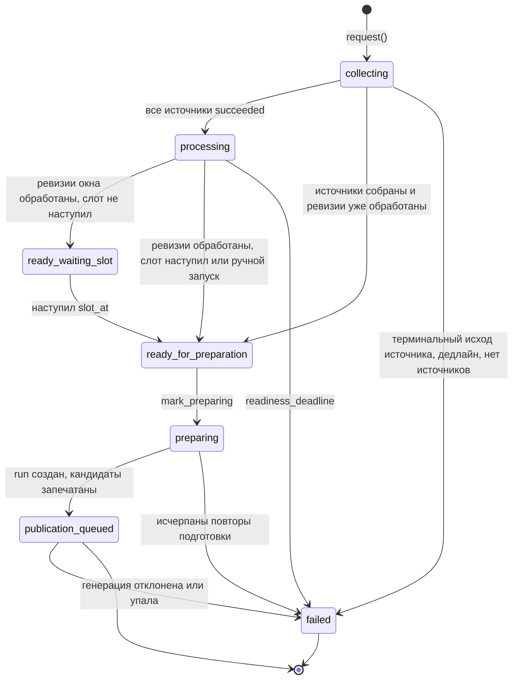

## Заявка на выпуск и готовность

Процесс простыми словами — в [Сценарии 2](#l2-digest) и [Сценарии 1](#l2-ingestion). Почему фильтр не барьер — [ADR-0004](#adr-0004).

::: tldr
**TL;DR для разработчика.** Заявка — строка `publication_refresh_runs` с устойчивым `request_key`. Её создают `publication_schedule_dispatcher` (каждую минуту) или ручная команда; `PublicationOrchestrator.reconcile` под блокировкой строки переводит её по машине состояний и ставит только недостающую работу. Готовность = все источники `succeeded` и все ревизии окна обработаны; Gate барьером не является. На переходе в `ready_for_preparation` фиксируется `knowledge_snapshot_at`, затем `prepare_publication_from_intent` создаёт `publication_runs` и запечатывает кандидатов.
:::

### Машина состояний заявки

### Trigger (Триггер)

- **По расписанию:** `due_publication_actions(config, scheduled_for)` в `publication_schedule_dispatcher`. На минуте `slot − pre_publish_lead_minutes` создаётся заявка и запускается сбор; на минуте слота та же заявка сверяется. Минута слота считается «своей» в окне `DEFAULT_CATCH_UP_WINDOW_MINUTES = 120`, поэтому простой воркера до 2 часов не теряет выпуск.
- **Вручную:** команда бота `/digest` или `/article` → `request_publication` (`src/publication/facade.py`) → `orchestrator.request(trigger="manual", requested_by_user_id=…)`. Команды принимаются только от `settings.admin_user_ids` (по умолчанию — `target_user_id`) и с ограничением частоты.
- **Сверка:** каждую минуту диспетчер вызывает `reconcile` для всех незавершённых заявок (`list_reconcilable_refresh_runs`).
- **Итоги периода** создаются без строк `publication_refresh_sources` и без сбора: готовность проверяет `_reconcile_period_review` по хронике ([Хроника и итоги периода](#l3-period-review-detail)).

### Input (Входные данные и контракты)

| Поле | Значение | Откуда |
| --- | --- | --- |
| `request_key` | Плановая: стабильный ключ `scheduled_request_key(edition, type, slot)`; повтор дайджеста — с префиксом `retry-N:`; ручная — `on-demand:<издание>:<тип>:<uuid>` | `src/jobs/schedules.py`, `src/publication/orchestrator.py` |
| `slot_at` | Время выпуска в UTC; дайджест 09:00, статья 21:15 по `Europe/Kyiv` | `settings.schedule_time`, `settings.article.schedule_time` |
| `freshness_cutoff_at` | `slot_at − publication_freshness_ttl_minutes` (30 мин) | `calculate_intent_times` |
| `deadline_at` | `slot_at + publication_readiness_deadline_minutes` (120 мин); для итогов периода — 72 ч | `calculate_intent_times`, `PERIOD_REVIEW_DEADLINE_MINUTES` |
| `lookback_hours` | Окно выпуска: 24 ч для дайджеста и статьи | `resolve_publication_lookback_hours` |
| `publication_refresh_sources` | Строка на каждый включённый источник издания: `pending` → `succeeded` | `EditionRepository.list_enabled_source_ids` |

### Processing (что не видно на диаграмме)

- `request()` и `reconcile()` работают в одной транзакции с `SELECT … FOR UPDATE` строки заявки; задачи (`scan_source`, `process_publication_authority_gap`, `prepare_publication_from_intent`) ставятся с `queueing_lock`, поэтому повторные тики диспетчера ничего не дублируют.
- Барьер ревизий считает необработанные ревизии в окне `[normal_source_cutoff_at − lookback_hours, normal_source_cutoff_at]`. Если их ноль — фиксируется `knowledge_snapshot_at` (`freeze_knowledge_snapshot`).
- Если у сюжетов окна нет актуального решения Gate, оркестратор ставит `process_publication_authority_gap`, но статус от этого не зависит: такие сюжеты исключаются при запечатывании кандидатов.
- Статья (не итоги периода) может переиспользовать замороженный снимок дайджеста того же издания, если он в окне свежести и с тем же `lookback_hours` (`find_reusable_frozen_refresh`) — тогда повторный сбор не нужен.
- Подготовка: `prepare_publication_from_intent` создаёт `publication_runs` (`request_key = publication-intent:<ключ заявки>`), вызывает `seal_candidates`, переводит заявку в `publication_queued` и ставит `select_stories_for_publication` — всё в одной транзакции.

### Output (Выходные данные и изменение состояния)

- `publication_refresh_runs.status`, `collection_ready_at`, `processing_ready_at`, `knowledge_snapshot_at`, `prepared_at`, `publication_run_id`, `error_kind`.
- `publication_runs` со статусом `created → candidates_sealed → selected_inputs_sealed → generating → succeeded | failed` и метаданными `refresh_run_id`, `scheduled_slot_at`, `trigger`.
- При `failed` — строки `publication_failure_notifications` для каждого получателя.

### Validation (Валидация и проверка прав)

- Ручной запуск: `BotCommandHandler.is_authorized` и ограничение частоты; окно `hours` проверяется `validate_hours`.
- Неизвестное издание — `ValueError` до создания заявки.
- `lookback_hours ≤ 0` — `ValueError`.

### Failure scenarios (Сценарии ошибок и обработка сбоев)

| `error_kind` | Когда | Что дальше |
| --- | --- | --- |
| `no_enabled_sources` | У издания нет включённых источников | Уведомление владельцу |
| `source_<исход>` | Любой источник завершил сбор терминальным исходом ([таблица исходов](#l3-ingestion-detail)) | Уведомление владельцу |
| `rate_limit_deadline` | Пауза Telegram заканчивается позже дедлайна | Уведомление владельцу |
| `readiness_deadline` | Сбор или обработка не завершились к `deadline_at` | Уведомление владельцу |
| `chronicle_not_ready` | Хроника не отметила период обзора завершённым к `deadline_at` ([итоги периода](#l3-period-review-detail)) | Уведомление владельцу |
| `publication_run_failed` и типы ошибок генерации | Генерация отклонена или упала | Для планового дайджеста — повтор ([детали](#l3-digest-detail)); коды статьи — [Статья](#l3-article-detail); иначе уведомление |

Уведомление получает инициатор ручного запуска; для плановых выпусков — все `admin_user_ids`. Уникальность `(refresh_run_id, recipient_user_id, failure_kind)` гарантирует одно уведомление на причину; неотправленные повторяются задачей `publication-failure-notification-redrive` каждые 5 минут.

### Guarantees / invariants (Гарантии системы)

- **Одна живая заявка на слот:** частичный уникальный индекс `uq_publication_refresh_runs_live_slot` по `(edition_id, publication_type, slot_at)` для строк не в `failed` и не превью. Проваленная заявка не мешает повтору на тот же слот.
- **Идемпотентность запроса:** `uq_publication_refresh_runs_request_key`; заявка в `preparing`, `publication_queued` или `failed` на повторный запрос не реагирует.
- **Снимок не сдвигается:** `knowledge_snapshot_at` пишется один раз; `prepare_publication_from_intent` без него отказывается работать.
- **Выпуск не начинается раньше слота:** плановая заявка, готовая заранее, ждёт в `ready_waiting_slot`.

### Implementation References:

- **Telebrief:** `src/jobs/schedules.py` (`due_publication_actions`, `publication_schedule_dispatcher`, `pre_publish_refresh`), `src/publication/orchestrator.py` (`PublicationOrchestrator`, `calculate_intent_times`), `src/publication/readiness.py` (`PublicationReadinessService`), `src/publication/readiness_repository.py`.
- **Telebrief:** `src/jobs/publication.py` (`prepare_publication_from_intent`), `src/publication/snapshot.py`, `src/publication/facade.py`, `src/core.py` (`generate_and_send_digest`), `src/bot_commands.py`.
- **Telebrief:** `src/publication/notifications.py`, `src/jobs/admin.py`; миграции `0028_publication_refresh_readiness.sql`, `0030_unified_publication_intents.sql`, `0033_publication_knowledge_snapshot.sql`, `0043_refresh_slot_barrier.sql`.

[↑ Сценарий 2 (Уровень 2)](#l2-digest)
