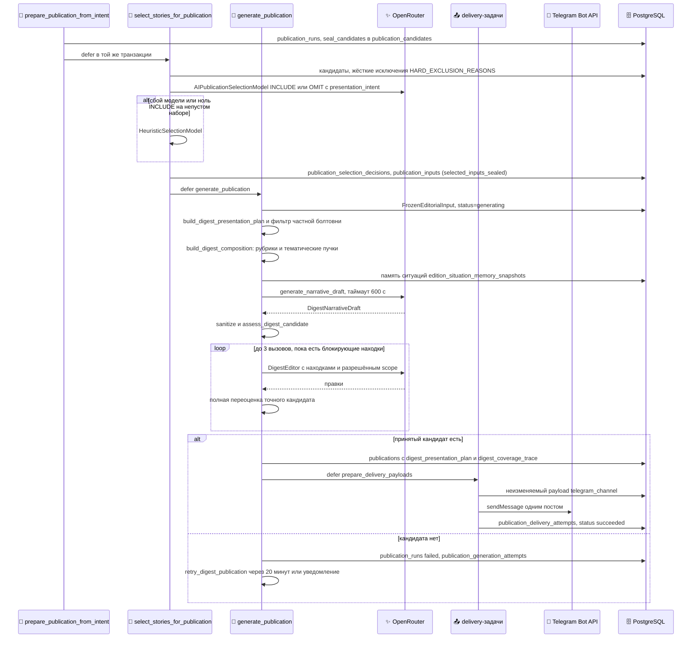

## Дайджест: отбор, генерация, проверка, доставка

Процесс простыми словами — в [Сценарии 2](#l2-digest). Почему без запасного текста — [ADR-0003](#adr-0003). Редакционные правила продукта — `AGENTS.md` §0.2 и §0.10 в корне репозитория.

::: tldr
**TL;DR для разработчика.** Цепочка задач очереди `publication`: `select_stories_for_publication` → `generate_publication` → `prepare_delivery_payloads` → `deliver_publication_payload`. Отбор — `FailOpenSelectionModel` (модель, при сбое — эвристика). Генерация (`publication_type = digest_grouped`, `digest_narrative_mode: single_call`): детерминированный `DigestPresentationPlan` и композиция по рубрикам → один вызов автора → `assess_digest_candidate` → до 3 вызовов `DigestEditor` с сохранением последней точно проверенной версии. Детерминированного запасного рендера нет: без принятого кандидата — `PublicationGenerationError`.
:::

### Полная последовательность

### Trigger (Тригер)

`prepare_publication_from_intent` после того как заявка стала `preparing` ([Заявка на выпуск](#l3-readiness-detail)). Каждая следующая задача ставится предыдущей в её транзакции.

### Input (Входные данные и контракты)

- **Кандидаты** — сюжеты издания со снимком на `knowledge_snapshot_at`, текущей ревизией, решением Gate `KEEP` и `scope_class ∈ {LOCAL, DIRECT_IMPACT}`; сюжеты без актуального решения исключаются.
- **Рубрики** — `settings.digest_rubrics.items` в `config.yaml` (`focus`, `infrastructure`, `safety`, `mobility`, `communications`, `health`, `civic_services`, `education_culture`, `society`, `environment`, `economy`, `other`) с `min_similarity: 0.38` для отнесения сюжета к рубрике.
- **Материал автора** — карточки сюжетов с фактами `PUBLISH`, цитируемым текстом и id опор. Текст родительского сообщения в ответе (`in_reply_to`) не цитируется; время наблюдения не показывается как дата события.
- **Модели** — слоты `OPENROUTER_MODEL` из `.env` по `AGENTS.md` §13.1; модель, не объявленная в `.env`, отклоняется `validate_model_allowed` до сетевого запроса.

### Processing (что не видно на диаграмме)

- **Отбор не проверяет факты.** `FailOpenSelectionModel` переходит на эвристику при исключении или если модель вернула ноль `INCLUDE` для непустого набора (кроме валидного случая «всё — реклама»).
- **Приоритет рубрик** при бюджете поста — `_PRIORITY_RUBRIC_WEIGHTS`: `focus` 110, `infrastructure` 100, `safety` 90, `civic_services` 80, `mobility` 75, `communications` 70, `health` 65 и ниже.
- **Частная болтовня.** `is_unlocated_outage_complaint` исключает из плана жалобу одного автора без места, где каждое слово из словаря статусов; несколько источников, официальное заявление или место в наблюдении сохраняют сюжет.
- **Эпизоды.** Сюжеты, связанные Gate как `same_incident`, образуют эпизод (`digest_episodes.py`): карточка из рубрики `other` наследует рубрику эпизода, а карточка конкретной рубрики не переезжает.
- **Бюджет длины.** Композиция целится в 2500–3700 знаков (`target_budget ≤ 3900`), проверка — 4096 видимых символов и 4096 единиц UTF-16. Если кандидат безопасен и полон, но длинный, третий вызов редактора перекомпоновывает разрешённые темы; обрезка запрещена.
- **Чекпойнты.** Каждая версия, прошедшая полную оценку, сохраняется как «последний точно проверенный кандидат». Неудачная правка не портит его, а находки отвергнутой правки передаются следующему вызову.

### Validation (Валидация)

`assess_digest_candidate` проверяет точный отрендеренный пост. Примеры кодов находок:

| Группа | Коды |
| --- | --- |
| Опора на источник | `UNSUPPORTED_DIGEST_RELATION`, `VISIBLE_PROSE_FACT_BINDING`, `VISIBLE_PLACE_FACT_BINDING`, `NON_PLACE_NAME_AS_PLACE`, `QUESTION_AS_META_NEWS` |
| Полнота | `SELECTED_STORY_COVERAGE`, `MATERIAL_FACT_COVERAGE`, `DIGEST_DUPLICATE_REQUIRED_FACT_ID` |
| Кухня сбора и мусор | `SOURCE_META_NARRATION`, `SOURCE_PROCESS_DESCRIPTION`, `CHAT_SLANG_OR_METADATA`, `CLASSIFIED_AD_LEAK`, `DIRECTORY_PAYLOAD_DOMINANCE`, `RAW_TECHNICAL_TOKEN` |
| Размер и форма поста | `TELEGRAM_SINGLE_POST_LIMIT`, `TELEGRAM_ENTITY_OFFSETS` |
| Предупреждения для редактора (сами по себе не блокируют) | `DIGEST_OVER_BUDGET`, `OVERLONG_SYNTHESIS`, `FRAGMENTED_SERVICE_REPORTS`, `REPETITIVE_GENERIC_HEADLINES`, `DUPLICATED_ATTRIBUTION`, `REPEATED_SUPPORTED_MEASUREMENT`, `DUPLICATE_LEADING_EMOJI` |

Связка, которую нельзя проверить детерминированно, помечается `NOT_EVALUATED`, а не «проверено».

### Output (Выходные данные и изменение состояния)

- `publications`: заголовок, пустой лид (`lead = ""` для группового дайджеста), тело; `metadata.digest_presentation_plan` (обязателен для аудита), `metadata.digest_coverage_trace`, `digest_quality_audit`, версии промптов (`digest-editorializer-v22-item-cohesion`, `digest-editor-v4-item-cohesion`).
- `publication_generation_attempts`: каждая попытка автора и редактора со статусом и `error_kind` (`digest_narrative_timeout`, `digest_narrative_synthesis_failed` и другие).
- `publication_delivery_payloads` — неизменяемый payload на платформу; `publication_delivery_attempts` — каждая попытка отправки.

### Constraints (Ограничения: таймауты, лимиты, повторы)

| Что | Значение | Где задаётся |
| --- | --- | --- |
| Таймаут автора | 600 с | `publication_editorial.digest_narrative_timeout_seconds` |
| Ответ автора | до 2800 токенов | `publication_editorial.digest_narrative_max_output_tokens` |
| Ответ отбора | до 8192 токенов | `publication_editorial.selection_max_output_tokens` |
| Вызовы редактора | до 3 | `_repair_digest_candidate` |
| Повторы задач `publication` | 3 попытки, 30 с + 60 с линейно | `PUBLICATION_RETRY_STRATEGY` |
| Повторы планового дайджеста | до 3 попыток, через 1200 с, не позже чем за 600 с до `deadline_at` | `DIGEST_RETRY_MAX_ATTEMPTS`, `DIGEST_RETRY_DELAY_SECONDS`, `DIGEST_RETRY_MIN_LEAD_SECONDS` |
| Запасной рендер | выключен | `digest_allow_deterministic_fallback: false` |
| Статистика | выключена | `include_statistics: false` |

### Failure scenarios (Сценарии ошибок и обработка сбоев)

- **Автор упал или вышел по таймауту** — попытка `failed`; при выключенном запасном рендере — `PublicationGenerationError`.
- **Нет принятого кандидата после редактора** — `PublicationGenerationError("DIGEST_AI_NARRATIVE_REQUIRED…")`; нарушение инварианта покрытия — `DigestCoverageInvariantError`.
- **Плановый дайджест** — `_schedule_digest_retry` ставит `retry_digest_publication` с новым ключом `retry-N:`; уведомление владельцу отправляется, только если повтор не поставлен. Ручной запуск не повторяется.
- **Таймаут отправки в Telegram** — доставка получает статус `outcome_unknown`. Bot API не позволяет узнать, создан ли пост, поэтому `reconcile_outcome` возвращает `unknown`, и повторная отправка не выполняется: нужна ручная проверка канала.
- **Провайдер недоступен до пометки run как `failed`** — задача повторяется Procrastinate, заявка остаётся открытой.

### Guarantees / invariants (Гарантии системы)

- **Только проверенный текст:** публикуется последний кандидат с полной успешной оценкой; рендер не меняет его формулировки.
- **100% покрытие:** каждый сюжет `DigestPresentationPlan` и каждый обязательный факт представлены в тексте (`SELECTED_STORY_COVERAGE`, `MATERIAL_FACT_COVERAGE`, `DigestCoverageInvariantError`).
- **Нет дублей поста:** неизменяемый payload и запрет повторной отправки при неизвестном исходе.
- **Воспроизводимость:** вход генерации — запечатанные `publication_inputs` на снимке; превью (`scripts/preview_digest.py`) проходит тот же путь без доставки.

### Расхождения с `AGENTS.md`

`AGENTS.md` §5.1 и §5.3 описывают панель City Situation и откат на детерминированный черновик. В коде откат выключен, а при наличии тематических пучков автор не получает план City Situation (`situation_plan=None` в `generation.py`). Этот документ описывает поведение кода; приоритет имеет §0.2 ([Риски](#l3-risks)).

### Implementation References:

- **Telebrief:** `src/jobs/publication.py` (задачи, `_schedule_digest_retry`, `retry_digest_publication`), `src/publication/selection.py`, `src/publication/selection_ai.py` (`FailOpenSelectionModel`).
- **Telebrief:** `src/publication/generation.py` (`PublicationGenerationService`, `_repair_digest_candidate`), `src/publication/digest_presentation.py`, `src/publication/digest_composition.py`, `src/publication/digest_episodes.py`, `src/publication/digest_status_chatter.py`, `src/publication/situation_memory.py`.
- **Telebrief:** `src/publication/digest_narrative.py`, `src/publication/digest_editor.py`, `src/publication/digest_assessment.py`, `src/publication/digest_coverage.py`, `src/publication/digest_quality_diagnostics.py`, `src/publication/digest_relation_support.py`, `src/publication/renderers.py`.
- **Telebrief:** `src/publication/delivery.py`, `src/publication/adapters.py` (`TelegramChannelDestinationClient`), `src/ai_providers.py` (`validate_model_allowed`), `src/config/schemas/publication.py`.

[↑ Сценарий 2 (Уровень 2)](#l2-digest)
