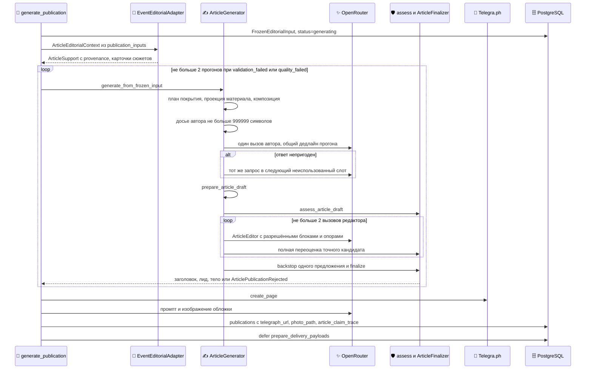

## Статья: досье, автор, проверка, редактор, доставка

Процесс простыми словами — в [Сценарии 3](#l2-article). Почему так — [ADR-0005](#adr-0005), [ADR-0006](#adr-0006), [ADR-0003](#adr-0003). Редакционный контракт — `AGENTS.md` §0.3–§0.9 в корне репозитория.

::: tldr
**TL;DR для разработчика.** Та же цепочка задач, что у дайджеста ([Заявка на выпуск](#l3-readiness-detail), [дайджест](#l3-digest-detail)), но `generate_publication` для типов статьи вызывает `_generate_article_with_run_retry` → `ArticleGenerator.generate_from_frozen_input`. Внутри: план покрытия → проекция материала → досье автора → один вызов автора → подготовка → `assess_article_draft` → до 2 вызовов `ArticleEditor` → `ArticleFinalizer`. Отказ проверки (`validation_failed`, `quality_failed`) повторяет весь прогон один раз. После принятия создаются страница Telegra.ph и обложка, затем пост в канал.
:::

### Полная последовательность

### Trigger (Триггер)

Плановая заявка `daily_article` в 21:15 по `Europe/Kyiv` или `weekly_article` по воскресеньям в 19:00 — в этот день ежедневная статья не создаётся (`due_publication_actions`). Ручной запуск — команда `/article` (окно 24 ч).

### Input (Входные данные и контракты)

- **Кандидаты** — как у дайджеста: сюжеты окна с решением Gate `KEEP` и `scope_class ∈ {LOCAL, DIRECT_IMPACT}`. Отбор для статьи возвращает короткий список приоритетов; остальные сюжеты получают `brief`, а не исключение. Больше 200 кандидатов (`ARTICLE_AI_SELECTION_MAX_CANDIDATES`) — сразу эвристический отбор.
- **`ArticleSupport`** — единица материала: id опоры, нормализованный факт, исходный `source_text`, вид свидетельства, `publication_use`, роль источника, id фрагментов и сообщений, время, временная роль, подача; необязательная подсказка темы из `service_access.service_state` (только точные ключи: `water_supply` → `water`, `power_supply` → `power` и т. д.).
- **Окно:** `lookback_hours` 24 для ежедневной, 168 для недельной (`resolve_publication_lookback_hours`).

### Processing (что не видно на диаграмме)

- **План покрытия** (`build_article_coverage_plan`): глубина `DEVELOP` / `WEAVE` / `BRIEF` и якорные детали. Для недели — `cluster_stories_into_threads` и `build_longitudinal_coverage_plan`, плюс уже вышедшие публикации недели (`query_anchor_publications`).
- **Проекция материала** (`project_article_material`): контакты, ссылки бронирования и прайс-листы убираются из текста для автора; опора, у которой после этого не осталось текста, не показывается. Сюжет убирается, только если пусты все его не-вопросные опоры `PUBLISH`. Исходные опоры и provenance сохраняются.
- **Досье** (`build_article_writer_input`): сначала справка по полям и полный список цитируемых фактов, затем навигация по композиции, география, счётчики и список разрешённых цитат. Строки-границы материала экранируются внутри досье. Сначала пробуется полная форма; если она длиннее 999 999 символов — компактная, без потери фактов, id и provenance; если не влезает и она — отказ до вызова модели.
- **Ранний отказ:** если у окна нет ни одной текущей опоры `PUBLISH`, на которую мог бы опереться заголовок или лид, — `global_incompleteness` без вызова модели.
- **Ответ автора:** непригодным считается только пустой или неразборчивый ответ без прозы, а также отказ или служебное сообщение целиком (`chat_completion_with_acceptance`). Тогда тот же запрос один раз уходит в следующий неиспользованный слот. Короткий текст, нет заголовка или лида, низкое покрытие — не повод для замены: это находки для редактора.
- **Подготовка** (`prepare_article_draft`): нормализация уже подтверждённой атрибуции, пометка «район не указан» для «частного сектора», кавычки вокруг названий заведений, замена «в чатах», «перекличка», «в комментариях» на нейтральные формулировки (`article_kitchen.py`). Цитаты не меняются, абзацы не удаляются.
- **Редактор** (`ArticleEditor.edit_draft`): правки текста по блокам и структурные операции `MOVE` (перенос абзаца без изменений), `RECOMPOSE` (замена разрешённых абзацев), `CREATE_SECTION` (только если нет подходящего раздела). Идентификаторы блоков действуют один проход и привязаны к отпечатку всего черновика. Все структурные операции ответа применяются атомарно; если полная переоценка нашла новую блокирующую находку или не смогла сопоставить её с изменённым блоком — откат всего пакета. Утверждения переписанного текста заново сопоставляются только с явно разрешёнными опорами.
- **Backstop:** блокирующая фактическая находка, указывающая на абзац, может быть снята удалением одного названного предложения; `PHANTOM_HEADING_TOPIC` — удалением подтемы после двоеточия в заголовке. Затем — полная переоценка; итог `sentence_trim_accepted` или `sentence_trim_rejected`.
- **Финализация** (`ArticleFinalizer`): шлюз на точном проверенном кандидате, без удаления цитат и абзацев; рендер сохраняет формулировки.

### Validation (Валидация)

Две независимые группы находок:

| Группа | Кто решает | Блокируют публикацию | Примеры кодов |
| --- | --- | --- | --- |
| Evidence Boundary | `article_validator.py` | Да, если остались после редактора | `UNSUPPORTED_CONCRETE_CLAIM`, `UNSUPPORTED_PROPER_NAME`, `UNSUPPORTED_CAUSAL_RELATION`, `UNSUPPORTED_MECHANISM`, `UNSUPPORTED_DIRECT_QUOTE`, `QUESTION_CONTEXT_OVERCLAIM`, `UNSUPPORTED_PROXIMITY_RELATION`, `CHAT_KITCHEN_LEAK`, `UNKNOWN_SUPPORT_ID` |
| Качество для читателя — блокирующие | `article_quality_policy.py` | Да | `CONTRADICTORY_SERVICE_STATE`, `CONSECUTIVE_DIRECT_SPEECH_ROLL`, `ARTICLE_PLACE_AREA_MISMATCH`, `HEADING_AREA_MISMATCH`, `NON_PLACE_NAME_AS_PLACE`, `OVERLOADED_ROSTER_PARAGRAPH`, `MULTI_SENTENCE_ADDRESS_STATUS_ROSTER`, `DIRECTORY_TIMETABLE_SECTION` |
| Качество для читателя — правки | `article_quality_policy.py` | Нет: редактору или диагностика | `QUOTE_ROLL_PARAGRAPH`, `THEME_MISMATCHED_SECTION`, `COLLOQUIAL_AUTHOR_PROSE`, `PRIVATE_SECTOR_AREA_UNSPECIFIED`, `REPEATED_CENTRAL_THESIS`, `MISSING_DEVELOP_STORY` (только «готовность неполная») |

Код качества, которого нет в реестре `_POLICIES`, — ошибка конфигурации, а не безопасная находка. Написание сверяется со свёрткой регистра, `ё/е`, украинских пар букв и апострофов; неизвестные имена, числа и слова цитат по-прежнему блокируют.

### Output (Выходные данные и изменение состояния)

- `publications`: заголовок, лид, тело в Markdown; `metadata.telegraph_url`, `photo_path`, `image_prompt`, `article_claim_trace` (привязка утверждений к опорам).
- `publication_generation_attempts`: попытки автора и редактора с исходом ответа (`writer_response_disposition`) и исходами блоков.
- **Пост в канале** (`_render_payload`): при обложке — фото с подписью (заголовок и лид, не больше 1000 символов), при ссылке Telegra.ph — кнопка «⚡️ Читать статью полностью». Для недели и итогов периода — плашка «ИТОГИ НЕДЕЛИ» и т. п. и дополнительная доставка `telegraph`.
- **Обложка:** модель пишет описание сцены по тексту статьи с учётом визуальных заметок профиля издания, затем модель `OPENROUTER_IMAGE_MODEL` рисует изображение; файл сохраняется в `data/articles`.

### Constraints (Ограничения)

| Что | Значение | Где задаётся |
| --- | --- | --- |
| Дедлайн одного прогона | 2400 с; итоги периода — 10 800 с | `article.article_generation_timeout_seconds`, `article.period_review_generation_timeout_seconds` |
| Прогоны | 2 (повтор только при `validation_failed`, `quality_failed`) | `ARTICLE_RUN_MAX_ATTEMPTS`, `ARTICLE_RUN_RETRY_REASONS` |
| Ответы автора | до 2 непустых (второй — только при непригодном первом) | `chat_completion_with_acceptance` |
| Вызовы редактора | 2 (настройка 3 ограничивается двумя) | `min(article_editor_max_attempts, 2)` |
| Ответ автора | до 131 072 токенов | `article.editorial_writer_max_output_tokens` |
| Ответ редактора | до 32 768 токенов | `ArticleEditor.max_output_tokens` |
| Досье | 999 999 символов | `article_writer_context.py` |
| Пакеты опор редактора | 64 пакета, 32 000 символов всего, 4 000 на пакет | `_MAX_EDITOR_SUPPORTS`, `_MAX_EDITOR_SUPPORT_CONTEXT_CHARS`, `_MAX_EDITOR_SUPPORT_PACKET_CHARS` |
| Слова | мягкая цель до `min(article_max_words, hard_max_words)`, сейчас 2400 | `publication_editorial.article_max_words`, `article_length.py` |
| Разделы | до 8 | `publication_editorial.article_max_sections` |

Профиль длины (`derive_article_length_profile`): «тонкий» день — не больше 4 сюжетов или 8 опор `PUBLISH`, «стандартный» — до 10 сюжетов или 24 опор, иначе «насыщенный». Счётчики богатства композиции — контекст для автора, не квота и не шлюз.

### Failure scenarios (Сценарии ошибок и обработка сбоев)

| `reason` | `error_kind` | Когда | Что дальше |
| --- | --- | --- | --- |
| `validation_failed` | `article_validation_rejected` | Блокирующая находка Evidence Boundary осталась после редактора и backstop | Повтор прогона; второй отказ — заявка `failed`, уведомление |
| `quality_failed` | `article_quality_rejected` | Блокирующая находка качества осталась | То же |
| `writer_failed` | `article_writer_rejected` | Автор не дал пригодного ответа | Без повтора прогона: заявка `failed`, уведомление |
| `global_incompleteness` | `article_global_incompleteness_rejected` | Нет опоры для заголовка и лида | Без вызова модели: заявка `failed`, уведомление |

- **Telegra.ph или обложка не создались** — предупреждение в логе, статья публикуется без них.
- **Сбой провайдера или таймаут до пометки run как `failed`** — задача повторяется Procrastinate; после пометки — заявка закрывается как `failed`.

### Guarantees / invariants (Гарантии системы)

- **Fail-closed:** без кандидата, прошедшего полную оценку, нет строки `publications` и нет доставки ([ADR-0003](#adr-0003)).
- **Слова цитат неизменны:** ни подготовка, ни редактор, ни финализация не меняют текст внутри сохранённой прямой цитаты.
- **Структурная правка атомарна:** пакет операций либо принят целиком после полной переоценки, либо откатан к точному предыдущему чекпойнту.
- **Сюжет не удаляется отбором:** отбор задаёт глубину; удалить можно только сюжет без единой опоры с текстом.
- **Превью безопасно:** `scripts/preview_article.py --run-id` повторяет прогон на замороженных данных, ничего не публикует и не создаёт страниц и обложек.

### Implementation References:

- **Telebrief:** `src/jobs/publication.py` (`generate_publication`), `src/publication/generation.py` (`_generate_article_with_run_retry`, Telegra.ph и обложка), `src/publication/event_editorial_adapter.py`, `src/publication/selection_ai.py`.
- **Telebrief:** `src/article_generator.py` (`ArticleGenerator._generate_from_event_article_context`), `src/publication/article_coverage.py`, `src/publication/article_material.py`, `src/publication/article_composition.py`, `src/publication/article_writer_input.py`, `src/publication/article_writer_context.py`, `src/publication/article_length.py`, `src/publication/story_threads.py`.
- **Telebrief:** `src/publication/article_finalization.py`, `src/publication/article_validator.py`, `src/publication/article_quality_policy.py`, `src/publication/article_editor.py`, `src/publication/article_kitchen.py`, `src/publication/article_trace.py`, `src/publication/errors.py`.
- **Telebrief:** `src/publication/delivery.py` (`_render_payload`), `src/publication/adapters.py`, `src/telegraph.py`, `src/image_generator.py`, `src/ai_providers.py` (`chat_completion_with_acceptance`).

[↑ Сценарий 3 (Уровень 2)](#l2-article)
