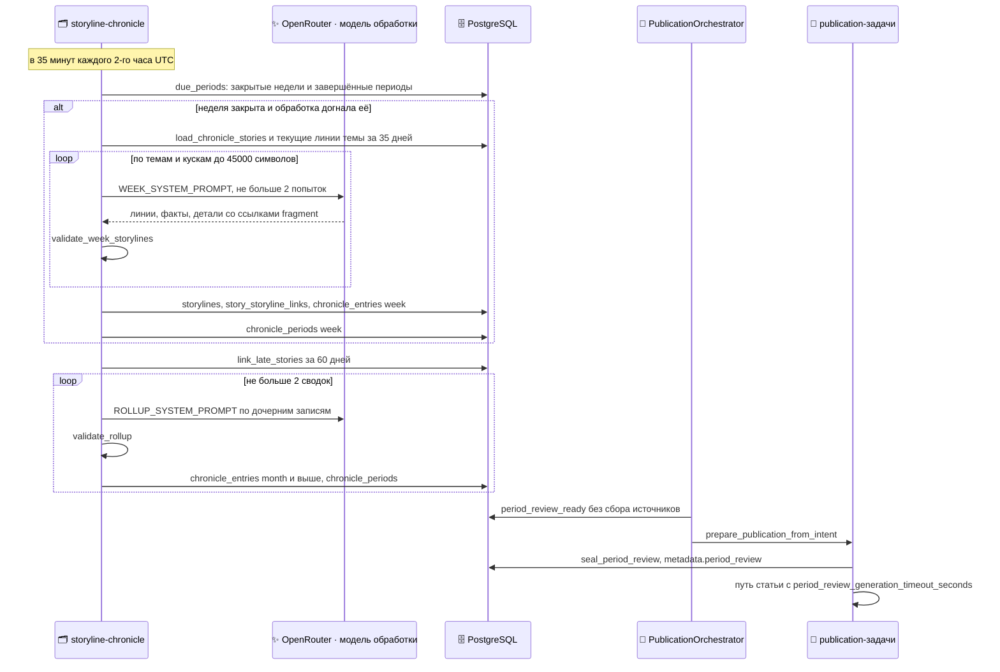

## Хроника сюжетных линий и итоги периода

Процесс простыми словами — в [Сценарии 4](#l2-period-review). Почему так — [ADR-0007](#adr-0007). Редакционный контракт — `AGENTS.md` §0.12 в корне репозитория.

::: tldr
**TL;DR для разработчика.** Периодическая задача `storyline-chronicle` (очередь `maintenance`) вызывает `advance_chronicle`: строит не больше одной закрытой недели, привязывает поздние сюжеты и сворачивает не больше двух завершённых периодов. Обзор (`monthly_article`, `quarterly_article`, `half_year_article`, `yearly_article`) готов, когда `chronicle_periods` отмечает его период; `seal_period_review` запечатывает сюжеты, на которые ссылаются записи хроники, и кладёт план обзора в `publication_runs.metadata.period_review`. Дальше — путь статьи ([Статья](#l3-article-detail)).
:::

### Полная последовательность

### Trigger (Триггер)

- **Хроника:** `advance_storyline_chronicle`, cron `35 */2 * * *`, `queueing_lock="storyline-chronicle"`; выходит сразу, если `publication_editorial.chronicle_enabled: false`. Работает для всех включённых изданий.
- **Обзор:** заявка по расписанию из `PERIOD_REVIEW_SCHEDULES` и `config.yaml` (`monthly_article`, `quarterly_article`, `half_year_article`, `yearly_article`: день, месяцы, `18:00`).

### Input (Входные данные и контракты)

- **Сюжеты недели** (`load_chronicle_stories`): сюжеты с текущей ревизией и опорами `PUBLISH`, до 6 сообщений на сюжет (`MAX_REPORTS_PER_STORY`), тема по `story_theme` (семейства сервисов → темы `THEME_LABELS`).
- **Текущие линии темы** за `RUNNING_STORYLINE_DAYS = 35` дней, не больше `MAX_RUNNING_STORYLINES = 60` — чтобы новая неделя продолжала линию, а не открывала новую.
- **Модель:** `OPENROUTER_PROCESSING_MODEL` (та же, что у Gate), таймаут запроса `CHRONICLE_REQUEST_TIMEOUT_SECONDS = 900`, ответ до `MODEL_MAX_TOKENS = 32 000`.

### Processing (что не видно на диаграмме)

- **Порядок:** недели строятся строго по порядку; следующая не начинается, пока предыдущая не закрыта. Неделя режется на границе месяца.
- **Закрытие недели:** не раньше `WEEK_GRACE = 4 ч` после конца; если в окне недели есть необработанные ревизии или сюжеты с `analysis_dirty` (`week_backlog`), неделя ждёт, но не дольше `MAX_BACKLOG_WAIT = 48 ч`.
- **Проверка записи** (`validate_week_storylines`, `validate_rollup`): каждый факт ссылается на фрагменты своего входа; числа и даты факта должны встречаться в процитированном фрагменте (день публикации фрагмента считается указанным). Сводка цитирует только ссылки дочерних записей. Поле, не прошедшее проверку, отбрасывается.
- **Привязка сюжета:** `story_storyline_links` с первичным ключом `story_id` — одна линия на сюжет; `method = chronicle_model` или `theme_other` («прочие новости» темы).
- **Поздние сюжеты:** сюжет, разобранный после закрытия своей недели, привязывается к «прочим новостям» темы (`link_late_stories`, горизонт `LATE_LINK_DAYS = 60`).
- **Сводка периода:** самые тяжёлые линии темы остаются отдельными записями (`ROLLUP_STORYLINES_PER_THEME`: 20, за год 24), остальные сворачиваются в «прочие новости» с лучшими по источникам фактами (до `ROLLUP_OTHER_INPUT_FACTS = 60` на вход).
- **Вес линии** (`weight_score`): 4 × число активных дней + 2 × число источников + число сюжетов.
- **План обзора** (`build_review_plan`): глубина по весу — `DEVELOP_STORYLINES` (месяц 5, квартал 6, полугодие 7, год 8), `WEAVE_STORYLINES` (15/18/20/24), остальное `BRIEF`; в линии `DEVELOP` первые 3 сюжета развиваются, остальные вплетаются. Лимиты фактов `FACTS_BY_DEPTH` (12/6/3) с нижними порогами `FACT_FLOORS` (6/2/1); бюджет материала `MATERIAL_CHAR_BUDGET = 520 000` символов срезает сначала факты самых лёгких линий.
- **Запечатывание** (`seal_period_review`): сюжеты берутся в порядке линий, каждый — с последней ревизией и решением о scope на момент снимка. Текущая версия Gate сюжет повторно не фильтрует: период охватывает несколько её версий. Писателю видны только процитированные хроникой фрагменты.

### Output (Выходные данные и изменение состояния)

- `storylines` (тема, `kind`, заголовок, районы, первая и последняя дата, число сюжетов), `story_storyline_links`, `chronicle_entries` (заголовок, траектория, факты, детали, вес, тексты ссылок), `chronicle_periods` (отметка завершения периода, `coverage_start`, число вызовов модели).
- `publication_runs.metadata.period_review` — план обзора (`PERIOD_REVIEW_PLAN_VERSION = "period-review-v1"`), один и тот же для отбора, адаптера и повторного превью.
- Заголовок обзора: «Итоги октября 2026 года»; при неполном периоде — с фактическим охватом (`review_label`).

### Constraints (Ограничения)

| Что | Значение | Где задаётся |
| --- | --- | --- |
| За один запуск | 1 неделя, 2 сводки | `advance_chronicle(max_weeks, max_rollups)` |
| Вход недели | до 45 000 символов на кусок; сводка — до 100 000 | `WEEK_INPUT_CHARS`, `MAX_INPUT_CHARS` |
| Фактов в записи | неделя 8, сводка 12 (год 14) | `WEEK_FACTS`, `ROLLUP_FACTS` |
| Попыток вызова модели | 2, затем `ChronicleModelError` и повтор периода в следующий запуск | `_call_with_retry` |
| Ожидание хроники обзором | 72 ч после времени выпуска | `PERIOD_REVIEW_DEADLINE_MINUTES` |
| Дедлайн генерации обзора | 10 800 с | `article.period_review_generation_timeout_seconds` |
| Целевой объём | месяц 3500 слов, квартал 4000, полугодие 4500, год 5000 | `PERIOD_REVIEW_WORDS` |

### Failure scenarios (Сценарии ошибок и обработка сбоев)

- **Модель хроники дважды упала** — период не записывается и не отмечается завершённым; следующий запуск через 2 часа повторит его. Запасного текста, написанного кодом, нет.
- **Хроника не готова к дедлайну** — заявка `failed` с `error_kind = chronicle_not_ready`, уведомление владельцу.
- **Период не завершён при запечатывании** — `seal_period_review` бросает `ValueError`, подготовка повторяется Procrastinate.
- **Обзор отклонён проверкой** — как у статьи: один повтор прогона, затем `failed` и уведомление.

### Guarantees / invariants (Гарантии системы)

- **Одна линия на сюжет:** первичный ключ `story_storyline_links.story_id`.
- **Одна запись на линию и период:** `uq_chronicle_entries_period` по `(edition_id, storyline_id, period_kind, period_start, chronicle_version)`.
- **Одни «прочие новости» на тему:** `uq_storylines_theme_other`.
- **Хроника не источник:** writer получает опоры `PUBLISH` сюжетов, а не тексты записей хроники; Evidence Boundary не меняется.
- **Готовность монотонна:** период отмечается в `chronicle_periods` только после записи всех его недель или дочерних периодов.

### Implementation References:

- **Telebrief:** `src/jobs/maintenance.py` (`advance_storyline_chronicle`), `src/publication/chronicle.py` (`advance_chronicle`, `due_periods`, `build_week`, `build_rollup`, `link_late_stories`, `weight_score`), `src/publication/grounding.py`.
- **Telebrief:** `src/publication/period_review.py` (`period_review_ready`, `seal_period_review`, `build_review_plan`, `review_label`), `src/publication/readiness.py` (`_reconcile_period_review`), `src/publication/orchestrator.py`, `src/publication/snapshot.py`.
- **Telebrief:** `src/jobs/schedules.py` (`PERIOD_REVIEW_SCHEDULES`), миграция `0042_storyline_chronicle.sql`.

[↑ Сценарий 4 (Уровень 2)](#l2-period-review)
