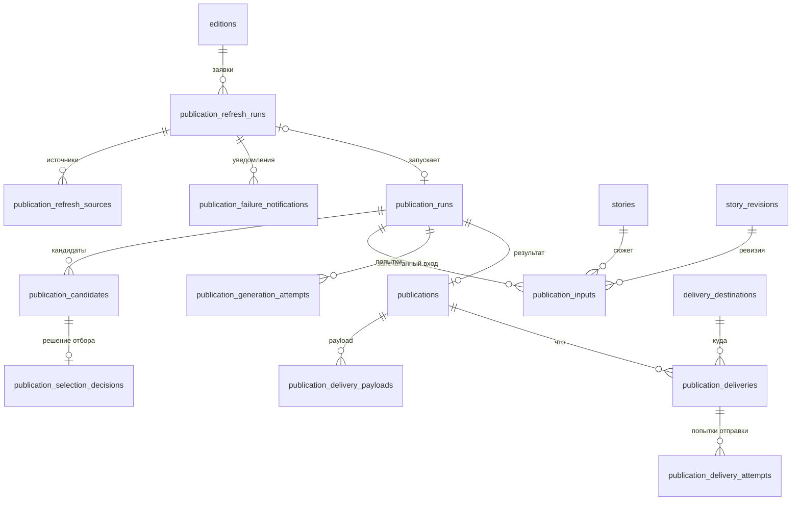
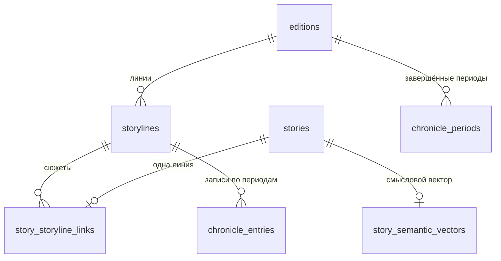

## Модель данных

Все данные и очередь задач живут в одной базе PostgreSQL с pgvector; схема создаётся миграциями `migrations/*.sql` (`scripts/migrate.py`). Здесь — карта таблиц по областям и связи публикации; связи знаний — в [Сборе и обработке](#l3-ingestion-detail).

::: tldr
**TL;DR для разработчика.** Пять областей: источники и сбор → знания (фрагменты, сюжеты, ревизии, решения Gate) → заявки и прогоны публикации → публикации и доставка → долговременная память (хроника, память ситуаций, смысловые векторы). Ключевые инварианты держатся уникальными ключами: одна живая заявка на слот, одна публикация на прогон, одна доставка на публикацию и назначение, одна сюжетная линия на сюжет.
:::

### Таблицы по областям

| Область | Таблицы | Подробно |
| --- | --- | --- |
| Издания и источники | `editions`, `sources`, `source_editions`, `collection_runs`, `collection_run_revision_observations` | [Сбор и обработка](#l3-ingestion-detail) |
| Знания | `source_items`, `source_item_revisions`, `source_fragments`, `source_fragment_embeddings`, `fragment_embedding_vectors`, `stories`, `story_fragments`, `story_cluster_state`, `story_revisions`, `story_event_triage_decisions`, `story_edition_scope_decisions`, `story_relations`, `event_revision_processing_state` | [Сбор и обработка](#l3-ingestion-detail) |
| Заявки на выпуск | `publication_refresh_runs`, `publication_refresh_sources`, `publication_failure_notifications` | [Заявка на выпуск](#l3-readiness-detail) |
| Прогон публикации | `publication_runs`, `publication_candidates`, `publication_selection_decisions`, `publication_inputs`, `publication_generation_attempts`, `publications` | [Дайджест](#l3-digest-detail), [Статья](#l3-article-detail) |
| Доставка | `delivery_destinations`, `publication_delivery_payloads`, `publication_deliveries`, `publication_delivery_attempts` | ниже |
| Долговременная память | `storylines`, `story_storyline_links`, `chronicle_entries`, `chronicle_periods`, `edition_situation_memory_snapshots`, `story_semantic_vectors` | [Хроника](#l3-period-review-detail), [Обслуживание](#l3-maintenance-detail) |
| Очередь задач | `procrastinate_jobs`, `procrastinate_events`, `procrastinate_periodic_defers` и др. | Схема Procrastinate |
| Прежние пути | `messages`, `legacy_imported_messages`, `claims`, `claim_*`, `story_claims` | [Риски](#l3-risks) |

### Публикация и доставка

### Хроника

### Ключевые ограничения

| Ограничение | Что гарантирует |
| --- | --- |
| `uq_publication_refresh_runs_live_slot` (частичный, без `failed` и превью) | Одна живая заявка на издание, тип и слот |
| `uq_publication_refresh_runs_request_key` | Повторный запрос с тем же ключом не создаёт вторую заявку |
| `uq_publication_candidates_run_story`, `uq_publication_inputs_run_story` | Сюжет входит в прогон один раз |
| `publications.publication_run_id UNIQUE` | Одна публикация на прогон |
| `uq_delivery_destinations_key` | Одно назначение на издание, платформу и адрес |
| `uq_publication_deliveries (publication_id, destination_id)`, `idempotency_key UNIQUE` | Одна доставка публикации в каждое назначение — база не даст создать второй пост |
| `story_storyline_links` PK `story_id` | Одна сюжетная линия на сюжет |
| `uq_chronicle_entries_period`, `uq_storylines_theme_other` | Одна запись линии за период; одни «прочие новости» на тему |

### Почему так

- **Ревизии, а не перезапись.** Сообщения и сюжеты хранят версии (`source_item_revisions`, `story_revisions`), а прогон публикации ссылается на конкретную ревизию. Поэтому выпуск можно воспроизвести на тех же данных, даже если сюжет потом изменился.
- **Payload отдельно от доставки.** Отрендеренный текст записывается один раз в `publication_delivery_payloads` и не меняется; повторная попытка отправляет тот же payload, а не рендерит заново.
- **Вектор можно обнулить, строку — нет.** Очистка обнуляет векторы, но сохраняет строки, чтобы внешние ключи и provenance не ломались ([ADR-0008](#adr-0008)).

### Implementation References:

- **Telebrief:** `migrations/0002_domain_foundation.sql`, `0003_collection_bookkeeping.sql`, `0006_embeddings_stories.sql`, `0008_publications.sql`, `0028_publication_refresh_readiness.sql`, `0030_unified_publication_intents.sql`, `0040_edition_situation_memory.sql`, `0041_vector_retention.sql`, `0042_storyline_chronicle.sql`; `src/db/`, `src/repositories/`, `src/publication/repository.py`, `src/publication/readiness_repository.py`.

[↑ Основные компоненты (Уровень 1)](#l1-components)
